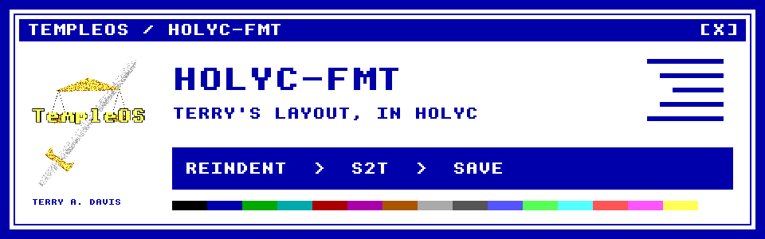

<p align="center">
  
</p>

# HolyC-fmt

**A HolyC formatter, written in HolyC.** Two-space indentation and TempleOS's tab storage, with strings, tokens and embedded sprites preserved.

**[Format HolyC in your browser →](https://templeosweb.netlify.app/Apps/Editor/Format.html)**

---

<details>
<summary><b>Use from a shell</b></summary>

<br>

Install Node.js and place HolyC-wasm beside this checkout:

```sh
git clone https://github.com/ParkerrDev/HolyC-wasm ../holyc-wasm
node cli.mjs File.HC                  # print formatted source
node cli.mjs -w A.HC B.HC             # rewrite in place
node cli.mjs --spaces --indent=4 F.HC # use spaces instead of tabs
```

Set `HOLYC_WASM` to use a different compiler checkout.

[JavaScript API and options](Doc/Guide.md#using-it)

</details>

---

<details>
<summary><b>Use in TempleOS</b></summary>

<br>

Copy `HolyCFmt.HC` and `FmtUtils.HC` to the same directory on the TempleOS disk, change to that directory, then run:

```c
#include "FmtUtils"
HolyCFmt("*","+r");
```

This rewrites matching source files recursively. The command is named `HolyCFmt` because TempleOS's own `Fmt` formats drives.

[Native command and buffer API](Doc/Guide.md#in-templeos)

</details>

---

<details>
<summary><b>Layout and checks</b></summary>

<br>

The formatter follows Terry's `EdRICode` reindentation and `S2T` space-to-tab storage. It leaves operator spacing alone and keeps DolDoc binary tails intact.

Checks cover token preservation and repeated-format stability across 544 exported V5.03 files, plus comparison with the same formatter running in native TempleOS. Of those exported files, 340 match Terry's layout byte for byte.

```sh
npm test
```

[Layout rules, corpus setup and native checks](Doc/Guide.md)

</details>

---

<details>
<summary><b>Credits</b></summary>

<br>

TempleOS, HolyC, the sword-and-scales artwork and the 8×8 system font were created by **Terry A. Davis**. TempleOS is public domain. The banner uses its font and artwork.

</details>
